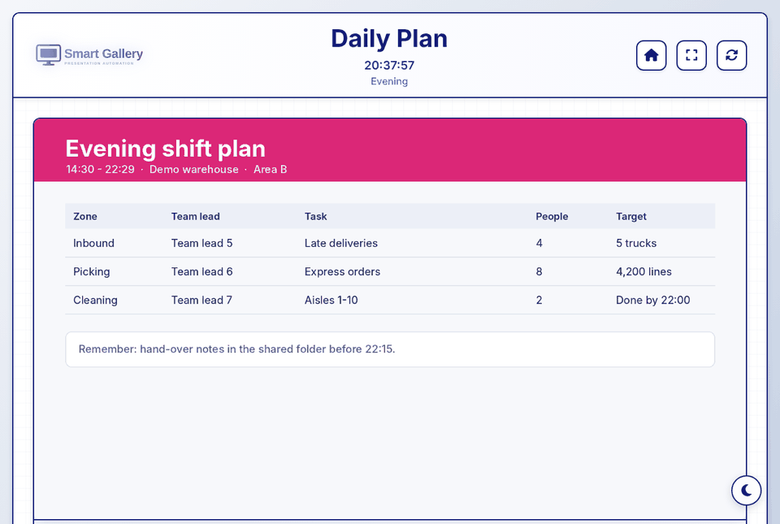
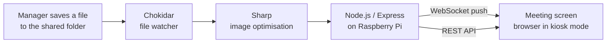
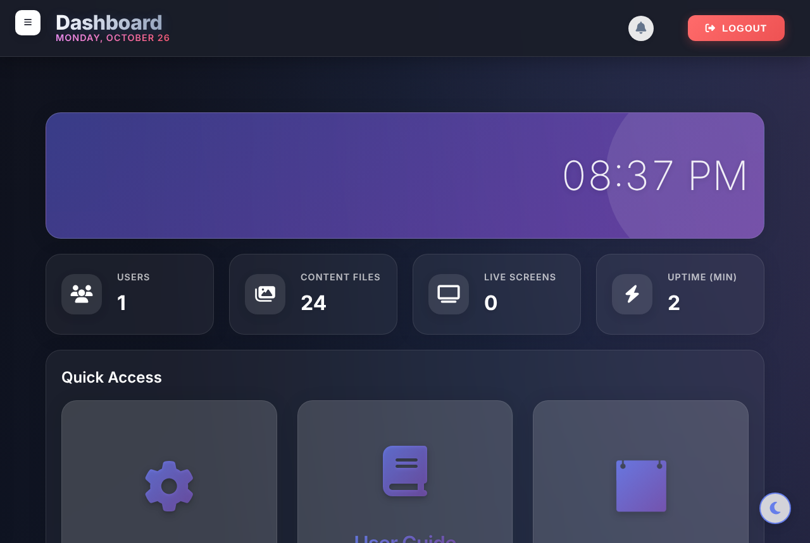
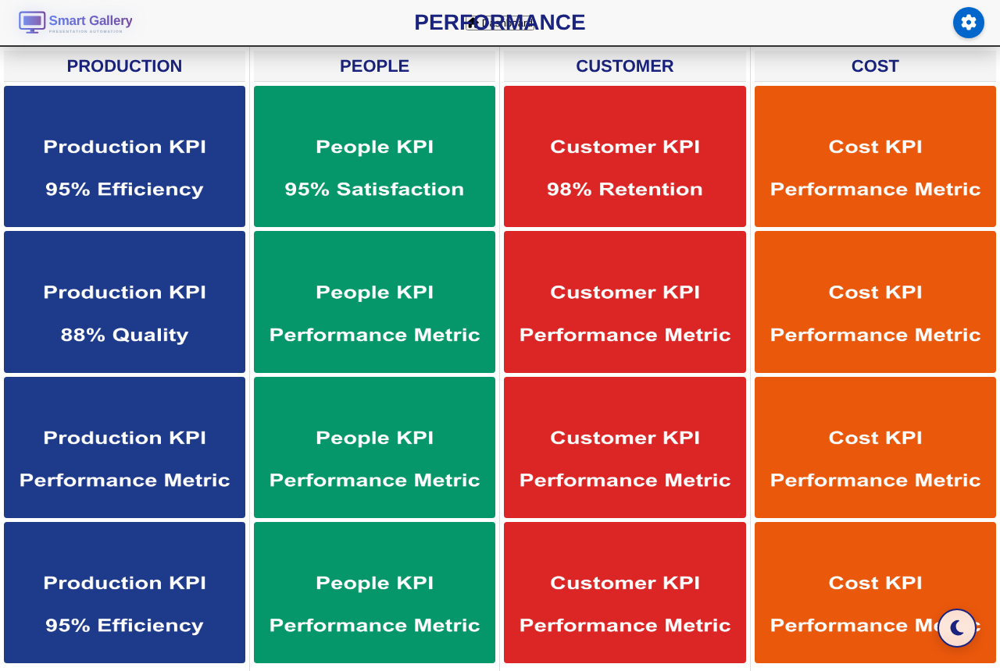
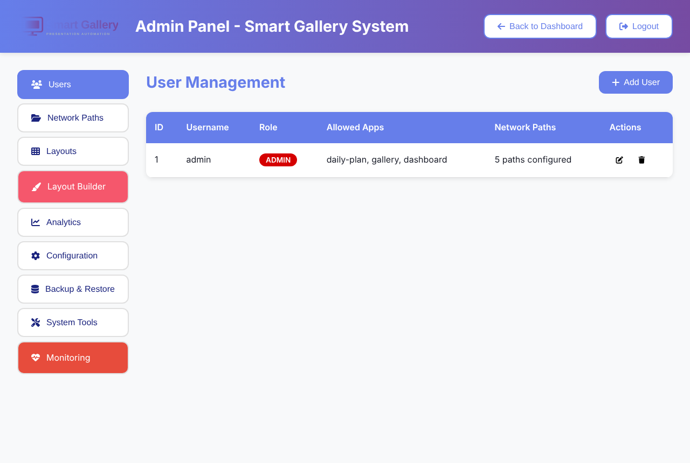

# Smart Gallery System

> Every morning, team leaders in the warehouse printed the day's plans and KPIs, walked to the board and pinned them up. When something changed, they did it again.
>
> Now they save a file to a folder, and every screen on the floor shows it about two seconds later.

**Offline-first presentation automation for warehouse meeting screens** — a small Node.js server on a Raspberry Pi behind each screen. No printing, no PowerPoint, no internet connection required.



*Above: a new evening plan is saved to the shared folder; the screen switches to it in about two seconds, without a page reload.*

---

## The problem

In the warehouse where this was piloted, team leaders prepared the morning and shift-change meetings by hand: printing plans and KPIs, pinning them to boards, and re-printing whenever something changed.

- 15–25 minutes of preparation every day per manager
- 250–600 printed pages per department per month
- Old printouts left on the board — people working from yesterday's targets

Commercial digital-signage tools did not fit: they need a stable internet connection (the warehouse Wi-Fi is not), a monthly subscription per screen, and an IT department to run them.

## The solution

A small Node.js server running on a **Raspberry Pi Zero 2 W** behind each meeting screen:

1. **Watches folders** on a shared network drive (Chokidar).
2. **Optimises new images** for the screen (Sharp) and builds thumbnails.
3. **Pushes the change to every open screen over WebSocket** — no polling, no reload.
4. Shows the right content automatically: the **daily plan switches by shift** (morning / evening / night), with the newest file on top.

Everything runs locally. No data leaves the site, which also keeps GDPR simple.



## Results from the pilot

Measured with warehouse managers during my bachelor project (interviews and a survey of 30 users):

| | Before | After |
|---|---|---|
| Daily meeting preparation | 15–25 min | under 5 min (~70% less) |
| Printed pages for the boards | 250–600 per department / month | none |
| Training needed | – | 0–15 minutes ("picked it up in one afternoon") |
| Usability rating | – | 9.5 / 10 |

## Features

- **Daily plan viewer** – picks the plan for the current shift and updates live
- **Image gallery** – folders of images/video, slideshow and "meeting mode" for the big screen
- **KPI dashboard** – Production / People / Customer / Cost boards from folders
- **Role-based access** – admins configure users, folders and layouts; operators only view
- **Admin panel** – users, network paths, layout builder, backup & restore, monitoring
- **Works offline** – all front-end libraries are served locally, no CDN calls

| Dashboard | KPI board | Admin panel |
|---|---|---|
|  |  |  |

## Tech stack

| Layer | Technology |
|---|---|
| Hardware | Raspberry Pi Zero 2 W + any HDMI screen |
| Backend | Node.js 20, Express, `ws` (WebSocket), Chokidar, Sharp, Multer |
| Auth & security | bcrypt password hashing, sessions + JWT, role-based access, per-route rate limiting, path allow-listing |
| Data | Local JSON files (users, config, layouts) — no database server needed |
| Frontend | Plain HTML/CSS/JavaScript, Chart.js, Font Awesome (served locally), PWA service worker |

## Quick start

Requires **Node.js 20.9+**.

```bash
git clone https://github.com/aleks-al-aleksandrov/smart-gallery-system.git
cd smart-gallery-system
npm install

cp .env.example .env          # set SESSION_SECRET, JWT_SECRET and ADMIN_PASSWORD
npm run init-admin            # creates the first admin account
npm run start:env             # http://localhost:3000
```

The admin account points at the demo content in `data/content/demo-images`, so the screens show something immediately. To try the real-time update, add or overwrite an image in `data/content/demo-images/daily-plan/<Shift>/` while the Daily Plan page is open.

On Windows you can also use `scripts/windows/SETUP.bat` and `scripts/windows/START.bat`.

### Running on a Raspberry Pi

Install Node.js 20, run the steps above, mount the shared drive (see [docs/diagrams/08-Deployment.md](docs/diagrams/08-Deployment.md)), start the server as a `systemd` service and open Chromium in kiosk mode on `http://localhost:3000/app/daily-plan`.

## Project structure

```
backend/
  server.js            Express app, WebSocket server, file watchers
  config.js            Loads config; secrets come from environment variables
  auth.js              Users, password hashing, roles
  routes/              daily-plan, gallery, dashboard, admin, upload, …
  utils/               image processing, monitoring, backup, path safety
frontend/              Pages and scripts for each app (no build step)
data/content/          Demo content (fictional)
docs/diagrams/         Architecture, sequence, security and data diagrams
docs/screenshots/      Screenshots of the running system
config.example.json    Default configuration (copied to data/config.json on first run)
```

## Design decisions

- **Offline-first instead of cloud.** The warehouse network drops regularly; a local server keeps the screens working and avoids per-screen subscriptions.
- **Event-driven instead of polling.** The file watcher pushes changes over WebSocket, so screens update in seconds while the Pi stays idle the rest of the time.
- **JSON files instead of a database.** A handful of users and settings do not justify running a database on a Pi; files are easy to back up and restore.
- **Newest file wins.** Managers do not rename or delete old plans — the most recently saved plan is the one on screen.

## What I would do next

- Automated tests for the file-watcher → WebSocket flow
- Move the remaining inline page scripts into modules and add a linter
- A small health endpoint for each Pi so one admin page can see all screens
- Replace the JSON user store with SQLite if the number of sites grows

## Background

Bachelor project, BSc Global Business Engineering (Software), VIA University College, Denmark (2025). The report covers the business case as well: market and competitor analysis, a 36-month total-cost-of-ownership comparison with cloud signage, and the pilot evaluation.

The first version (January 2025) was a single gallery page with a file watcher, built to replace printed boards in one department. This repository is the second version, rebuilt as a multi-app system for the bachelor project.

**Author:** Aleks Aleksandrov — [LinkedIn](https://www.linkedin.com/in/aleks-aleksandrov-42a472238/)

Licensed under the [MIT License](LICENSE).
